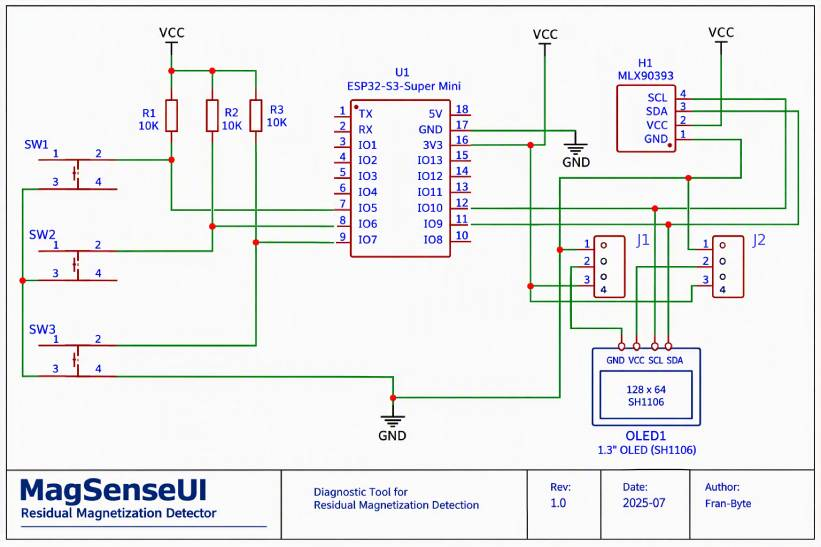
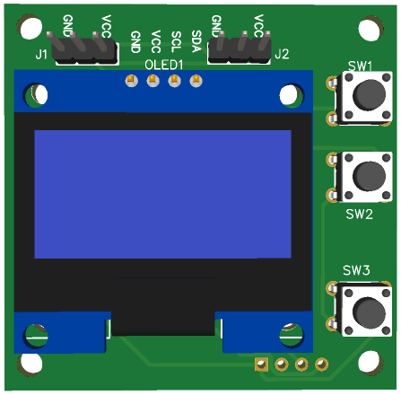
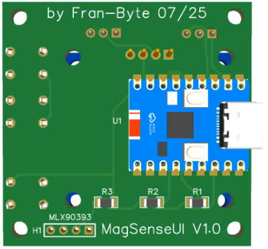
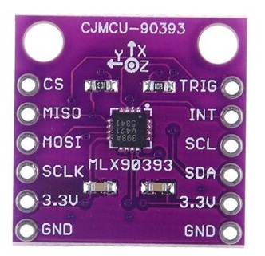
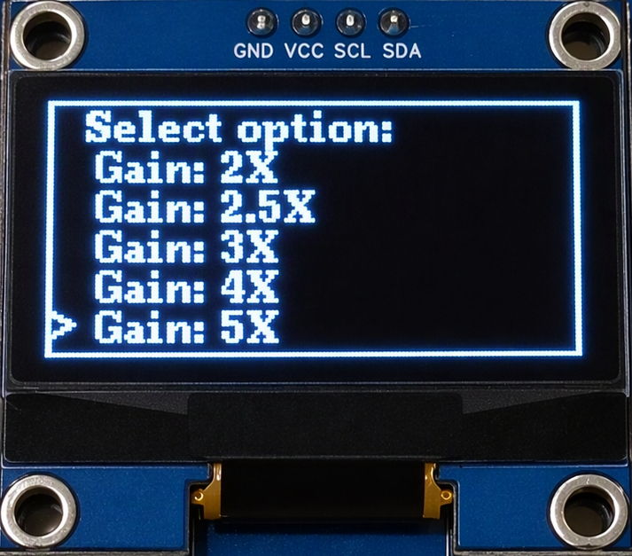
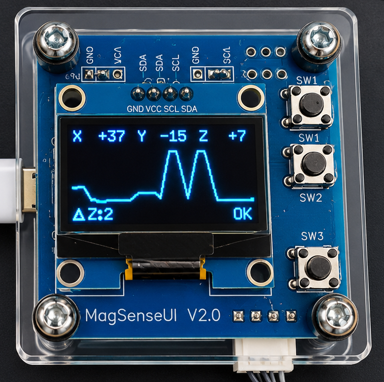
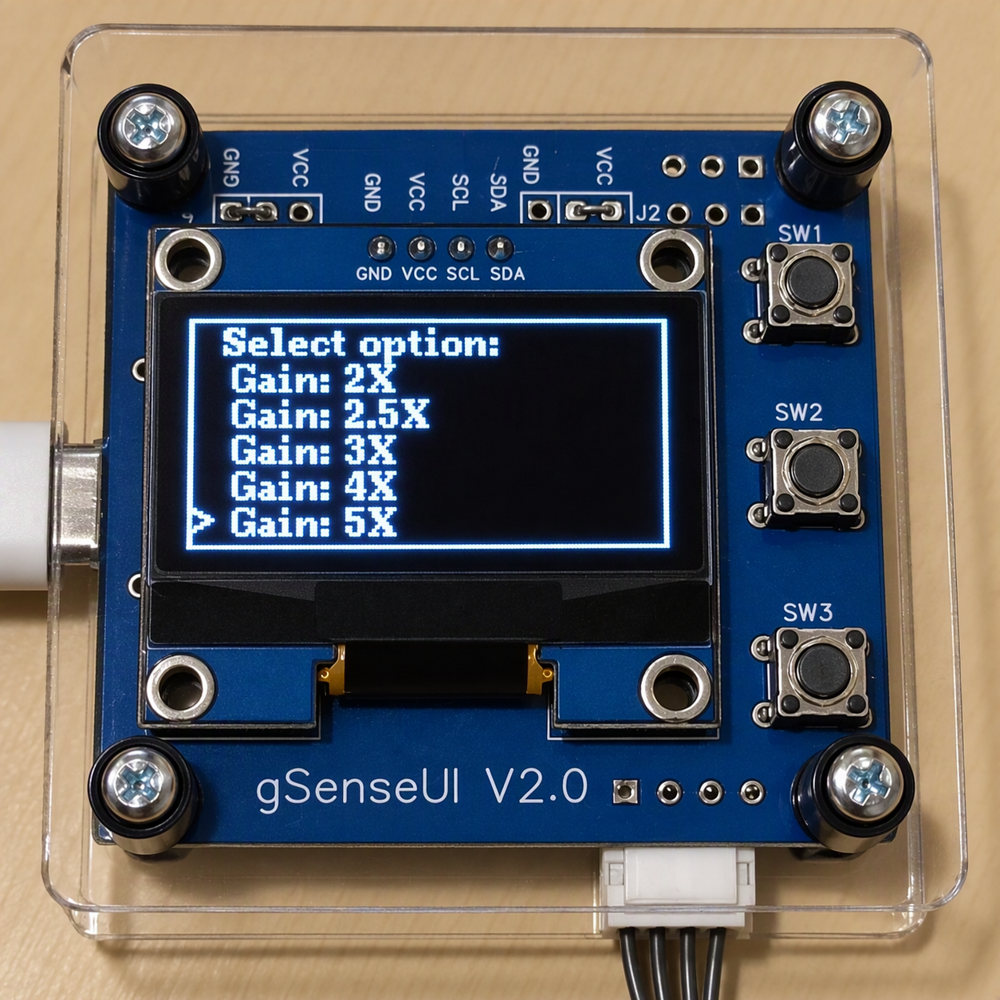
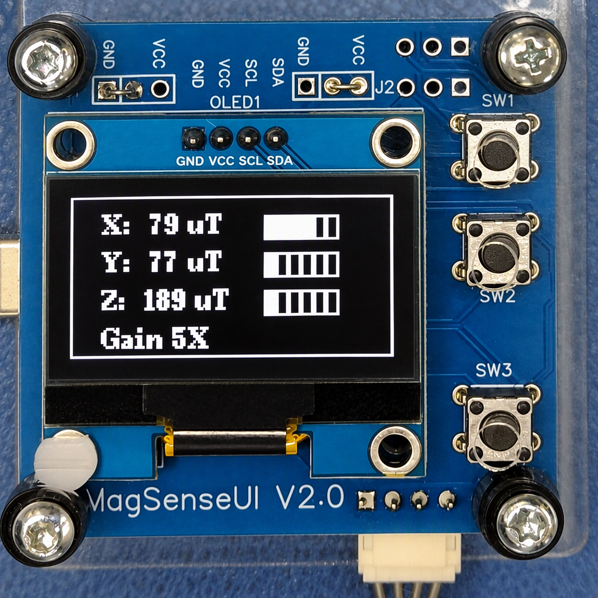
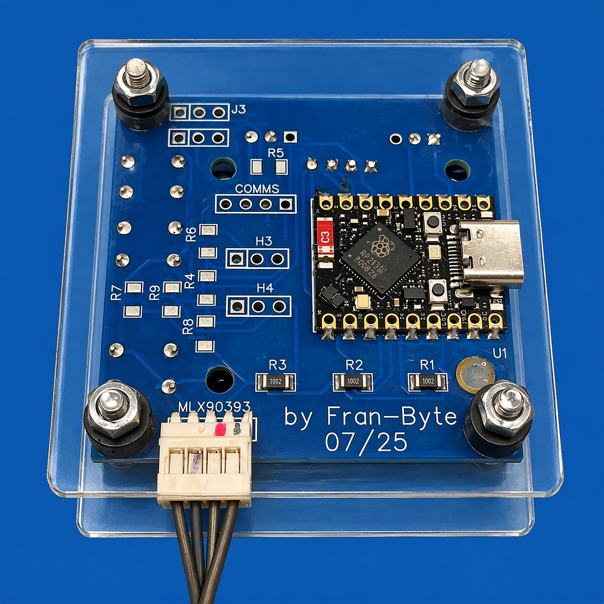
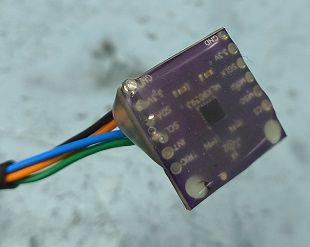

# MagSenseUI
# Herramienta de Diagnóstico para la Detección de Magnetización Residual


## 🎯 Propósito del Proyecto

El proyecto **MagSenseUI** fue desarrollado para abordar un desafío específico de diagnóstico en sistemas electromecánicos, particularmente en máquinas como los **validadores de billetes (Bill Validators)** que dependen de sensores magnéticos para su funcionamiento.

El programa incorpora un sistema de **menú intuitivo** que permite a los usuarios configurar la **ganancia del sensor** y elegir el modo de salida de datos. Los usuarios pueden seleccionar si las lecturas del campo magnético se muestran directamente en la pantalla OLED o se transmiten mediante el **puerto serie** del Arduino a un PC conectado. Esta flexibilidad facilita la adaptación del sistema tanto para diagnósticos autónomos en campo como para el registro y análisis detallado de datos en un ordenador.

## Características

- Monitorización en tiempo real del campo magnético en 3 ejes.
- Niveles configurables de ganancia del sensor MLX90393.
- Configuración del rango de gráfica, umbral de ADVERTENCIA y umbral de MAGNETIZADO (error).
- Interfaz gráfica OLED con dos vistas seleccionables (Moderna y Clásica).
- Línea de diagnóstico que muestra el eje con la mayor variación de campo (Δ).
- Almacenamiento en EEPROM de la ganancia, vista seleccionada y rangos configurados.
- Transmisión de datos por puerto serie para registro en PC.
- Funcionamiento portátil para diagnóstico.
- Detección de magnetización residual en rodamientos.

## 🧰 Componentes Hardware

| Componente | Descripción |
|------------|-------------|
| [Arduino ESP32](doc/esp32.webp) | Microcontrolador ESP32-S3 Super Mini |
| [Pantalla OLED 1.3"](doc/SH1106.pdf) | Pantalla monocroma SH1106 basada en I²C |
| [Sensor MLX90393](doc/MLX90393.PDF) | Magnetómetro de 3 ejes con ganancia ajustable |
| Pulsadores (x3) | Navegación por menús y selección |







- El sensor está montado sobre y conectado mediante cables para mejorar su rendimiento y maniobrabilidad.

- Otro aspecto importante es el uso de los jumpers J1 y J2, empleados para configurar las distintas versiones de las pantallas OLED de 1,3", ya que en algunas versiones los pines de alimentación están invertidos (positivo y negativo).

## 🧭 Sistema de Menús

```plaintext
[ Menú de Configuración ]
-------------------------
1. Gain: 5X
2. Serial ON
3. View: Modern
4. View: Classic
5. Range: 225 uT      (escala completa gráfica)
6. Warn: 125 uT       (umbral ADVERTENCIA)
7. Error: 175 uT      (umbral MAGNETIZADO)
8. Interval: 500 ms
```

Las opción 1 configuran la ganancia del sensor, la opción 2 habilita la transmisión por puerto serie y las opciones 3-4 permiten seleccionar la pantalla de medición (ver [Vistas de Pantalla](#vistas-de-pantalla)). La vista seleccionada se aplica inmediatamente y se guarda en EEPROM. Si el menú expira mientras el cursor está sobre una opción de vista, la vista no se aplicará.

Las opciones 5-8 son valores numéricos. Pulse SELECT para editarlos (el valor se muestra como `<125>`), UP para aumentar y DOWN para disminuir.

La opción SELECT guarda el valor en EEPROM y vuelve a la lista. Si el menú expira durante la edición, los cambios se descartan.

| Opción | Valor por defecto | Rango | Incremento |
|---------|-----------------:|--------|-----------:|
| Range (escala gráfica completa) | 225 uT | 25 - 1000 uT | 25 uT |
| Warn | 125 uT | 5 uT - (Error - 5) | 5 uT |
| Error | 175 uT | (Warn + 5) - 1000 uT | 5 uT |

La advertencia (Warn) siempre es inferior al umbral Error: el editor limita automáticamente los valores para mantener esta condición.

### 🧩 Contexto del Problema

Estas máquinas suelen trabajar en entornos donde existen **potentes imanes de neodimio** de forma permanente. Aunque estos imanes son esenciales para el funcionamiento de la máquina, también generan un **campo magnético constante** que puede interferir con los componentes cercanos.

Uno de estos componentes es el rodamiento metálico. En condiciones normales, el rodamiento no es magnético. Sin embargo, si se magnetiza debido a contaminación externa (por ejemplo, exposición a partículas magnéticas o proximidad prolongada a campos magnéticos intensos), puede alterar el entorno magnético local. Esta alteración puede provocar lecturas erróneas o fallos de funcionamiento en los sensores magnéticos de la máquina.

### 🧪 ¿Por qué MagSenseUI?

Aunque una brújula tradicional puede detectar magnetizaciones intensas, **no es capaz de detectar magnetizaciones sutiles o de bajo nivel**. Aquí es donde **MagSenseUI** destaca.

- Utiliza el magnetómetro tridimensional de alta resolución **MLX90393** para detectar incluso pequeñas anomalías magnéticas.
- El sistema permite seleccionar diferentes niveles de ganancia para aumentar la sensibilidad frente a campos débiles.
- Mediante una sencilla interfaz OLED y un modo de salida por puerto serie, proporciona información en tiempo real sobre la intensidad del campo magnético en microteslas (µT).
- Esto permite a los técnicos identificar qué rodamiento está magnetizado, incluso cuando la magnetización es mínima e invisible para las herramientas convencionales.

---

## Recursos Adicionales

Para los lectores que no estén familiarizados con las tecnologías utilizadas en este proyecto, puede encontrarse información detallada aquí:

- [Fundamentos de la comunicación I²C](doc/resources.md#i2c)
- [Reloj I²C (SCL)](doc/resources.md#i2c-clock)
- [Hoja de datos del MLX90393](doc/MLX90393.PDF)
- [Hoja de datos de la pantalla SH1106](doc/SH1106.pdf)

## 🔧 Especificaciones Técnicas

### 🧠 ESP32 Mini

El **ESP32 Mini** es un módulo microcontrolador compacto y de ultra bajo consumo basado en el chip **ESP32** de Espressif. Es ideal para aplicaciones embebidas que requieren Wi-Fi, Bluetooth y alta capacidad de procesamiento en un espacio reducido.

- **Microcontrolador:** CPU Xtensa LX7 de doble núcleo (hasta 240 MHz)
- **Dimensiones:** 22,52 × 18 mm
- **Memoria Flash:** 4 MB
- **SRAM:** 512 KB
- **ROM:** 384 KB
- **Entradas/Salidas digitales:** 11
- **Pines de interrupción externa:** 22
- **Entradas analógicas:** 6
- **Salidas PWM:** 11
- **Tensión de funcionamiento (lógica y alimentación):** 3,3 V
- **Tensión de entrada (a través del regulador):** 5 V (por ejemplo mediante adaptador USB-UART)
- **Consumo en Deep Sleep:** ~43 µA
- **Conectividad:** Wi-Fi 802.11 b/g/n, Bluetooth v4.2 BR/EDR + BLE
- **Funciones de seguridad:** AES-128/256, RSA, HMAC, firmas digitales y arranque seguro
- **LED integrado:** WS2812 RGB programable
- **Interfaces:** UART, I²C, SPI, PWM, ADC, DAC
- **Interfaz USB:** No incorporada (requiere adaptador USB-Serie externo para programación)


---

### 🧲 Sensor Magnético MLX90393

El **MLX90393** es un magnetómetro tridimensional de alta sensibilidad diseñado para la medición precisa de campos magnéticos.

El MLX90393 dispone de un amplio rango dinámico y ganancia programable, permitiéndole detectar pequeñas perturbaciones magnéticas superpuestas sobre campos magnéticos de fondo mucho más intensos generados por fuentes como imanes de neodimio.

- **Ejes de medición:** X, Y, Z
- **Salida:** Campo magnético en microteslas (µT)
- **Resolución:** Configurable (hasta 0,161 µT/LSB)
- **Ganancia:** De 1X a 5X (seleccionable)
- **Interfaz:** I²C (también compatible con SPI)
- **Dirección I²C:** 0x0C (por defecto)
- **Tensión de alimentación:** 2,2 V – 3,6 V
- **Consumo:** ~2,5 mA activo, ~1 µA en espera

### Características

- Ganancia, resolución, sobremuestreo y filtrado programables.
- Alta sensibilidad para detectar pequeñas variaciones magnéticas.
- Ideal para detección de posición sin contacto y mapeado de campos magnéticos.

### ⚠️ Limitaciones

El MLX90393 proporciona una resolución máxima aproximada de 0,161 µT/LSB. Las mediciones cercanas a este límite pueden verse afectadas por el ruido propio del sensor y por interferencias magnéticas del entorno.



---

### 🖥️ Pantalla OLED 1,3" (SH1106)

Esta pantalla OLED de **1,3 pulgadas** utiliza el controlador **SH1106** y se comunica mediante I²C. Es ideal para interfaces compactas en sistemas embebidos.

- **Resolución:** 128 × 64 píxeles
- **Tipo de pantalla:** OLED monocroma
- **Controlador:** SH1106
- **Interfaz:** I²C (SDA/SCL)
- **Tensión de funcionamiento:** 3,3 V – 5 V
- **Consumo:** Bajo (no requiere retroiluminación)
- **Ángulo de visión:** >160°
- **Bibliotecas compatibles:** U8g2, Adafruit SH1106, etc.



### La única diferencia consiste en la incorporación de GPIO adicionales reservados para futuras ampliaciones. El firmware y el circuito de sensado permanecen idénticos a la versión 1.







## Diagrama de Conexiones

## 🔌 Conexión de Componentes mediante I²C (ESP32 Mini)

### Pantalla OLED (SH1106)

- **SDA → GPIO9** PIN 11
- **SCL → GPIO10** PIN 12

### Sensor MLX90393

- **SDA → GPIO9** PIN 11
- **SCL → GPIO10** PIN 12

### Pulsadores

- **UP → GPIO5** PIN 7
- **DOWN → GPIO6** PIN 8
- **SELECT → GPIO7** PIN 9

## 🚀 Cómo Utilizarlo

1. Cargue el sketch `MagSenseUI.ino` en su Arduino.
2. Durante el arranque, puede pulsar SET para entrar en el menú de configuración. Utilice los botones para navegar y configurar la ganancia o la vista de pantalla. Si no se pulsa SET, el dispositivo omite el menú y comienza directamente las mediciones.
3. La configuración de ganancia y vista se guarda en EEPROM (ganancia en la dirección 0, vista en la dirección 1 y Range/Warn/Error como valores de 16 bits en las direcciones 2, 4 y 6). En una EEPROM vacía o inválida se utilizarán la Vista Moderna y los valores predeterminados 225/125/175 µT.
4. Opcionalmente puede habilitar el Modo Serie para transmitir datos en tiempo real (X, Y, Z en µT) hacia un PC.

## 🚀 Funcionamiento

Pulsar SET (o mantenerlo pulsado durante el arranque) abre el menú de configuración, donde el usuario puede navegar mediante los pulsadores y seleccionar la ganancia del sensor, la salida serie o la vista de pantalla.

Si no se pulsa SET, finaliza la cuenta atrás y el dispositivo comienza directamente las mediciones utilizando la configuración almacenada.

La ganancia seleccionada se recupera automáticamente desde la EEPROM, permitiendo conservar la configuración tras apagar y volver a encender el equipo.

Una vez finalizada la fase de configuración, el sistema comienza a monitorizar continuamente el campo magnético en los ejes X, Y y Z.

Cada 500 ms se realiza una nueva medición y se compara con la anterior. El sistema calcula la variación del campo magnético para cada eje y muestra una indicación visual del nivel de perturbación detectado.

### Niveles de Alerta

MagSenseUI compara cada medición con la anterior y calcula la variación magnética (Δ).

- Δ ≤ Warn (125 µT por defecto): Condición normal.
- Δ > Warn (125 µT por defecto): Advertencia (triángulo con `!`). Se detecta una pequeña perturbación magnética.
- Δ > Error (175 µT por defecto): Magnetizado (símbolo de radiación). Se detecta una perturbación significativa que indica una probable magnetización residual del componente inspeccionado.

El símbolo de advertencia indica una variación moderada del campo magnético, mientras que el símbolo de radiación indica una variación más intensa que podría estar causada por un componente cercano significativamente magnetizado.

Los umbrales son configurables desde el menú y son idénticos en ambas vistas.

Este método permite a los técnicos identificar rápidamente componentes con magnetización residual incluso cuando trabajan en presencia de fuertes campos magnéticos de fondo generados por imanes permanentes.

### Vistas de Pantalla

La pantalla de medición puede cambiarse desde el menú:

```plaintext
View: Modern
View: Classic
```

Ambas vistas utilizan el mismo cálculo Δ y los mismos umbrales.

#### Vista Moderna

```plaintext
X +1234   Y +0987   Z -456

      Gráfico histórico Δ

Δ Y:188              MAGNETIZADO
```

- **X / Y / Z:** campo actual de cada eje en µT.
- **Gráfico:** historial de la mayor variación Δ detectada entre ejes durante los últimos 10 segundos (21 muestras, una cada 500 ms), ocupando todo el ancho de la pantalla. Escala vertical fija desde 0 µT hasta el valor configurado en *Range* (225 µT por defecto). Δ es siempre positiva, por lo que la línea permanece en la base si no hay cambios y asciende cuando el campo varía. Solo se dibuja la curva, sin líneas de referencia, con un marcador en la muestra más reciente. Como Δ representa la diferencia entre muestras consecutivas, funciona igualmente bien incluso dentro de un campo magnético constante de gran intensidad.
- **Barra inferior:** a la izquierda aparece el Δ del eje con mayor variación (`Δ Y:188`). Siempre muestra el eje con mayor variación independientemente del estado. A la derecha aparece el estado: `OK`, `WARNING` o `MAGNETIZED`.
- Cuando el estado es MAGNETIZED, la barra aparece invertida y parpadea cada 500 ms.
- La ganancia seleccionada no se muestra en esta vista.

#### Vista Clásica

Cada eje muestra su valor y un gráfico de barras de seis segmentos que representa la magnitud de la variación del campo magnético.

- 0 barras: No se detecta una variación significativa.
- 6 barras: Variación igual o superior al umbral Warn.
- Símbolo de advertencia: Variación superior al umbral Warn en ese eje.
- Símbolo de radiación: Variación superior al umbral Error en ese eje.

La línea inferior muestra el Δ del eje con mayor variación a la izquierda (`Δ Y:188`; siempre visible independientemente del estado) y el estado (`OK`, `WARNING`, `MAGNETIZED`) a la derecha.

## Resultados de Validación

| Objeto de Prueba | Δ Máximo (µT) | Estado |
|------------------|-------------:|---------|
| Rodamiento de Referencia | 32 | Normal |
| Rodamiento A | 94 | Normal |
| Rodamiento B | 143 | Advertencia |
| Rodamiento C | 221 | Magnetizado |

📂 **Código**: [Ver Código Fuente](magSenseUi/)

## 📄 Licencia

Este proyecto está licenciado bajo la licencia MIT.

## 🙌 Créditos

Desarrollado por **Fran-Byte**. Basado en sensores magnéticos Melexis y bibliotecas Arduino.
