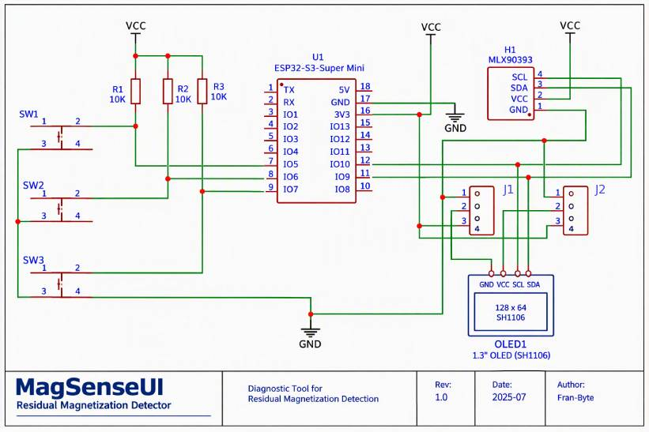
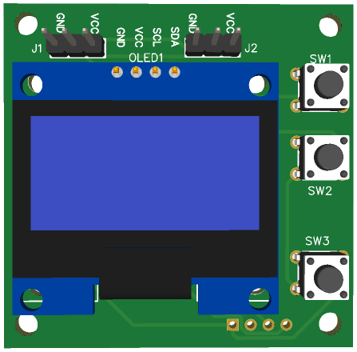
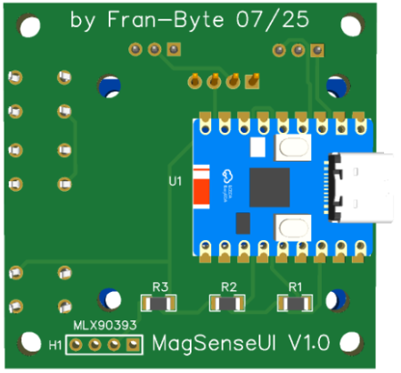
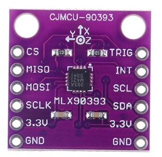
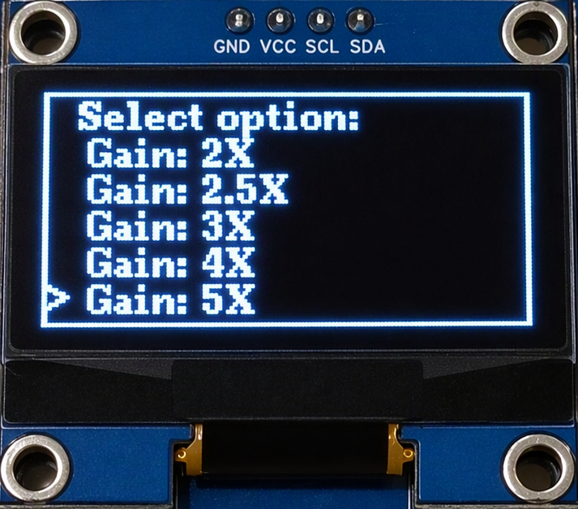
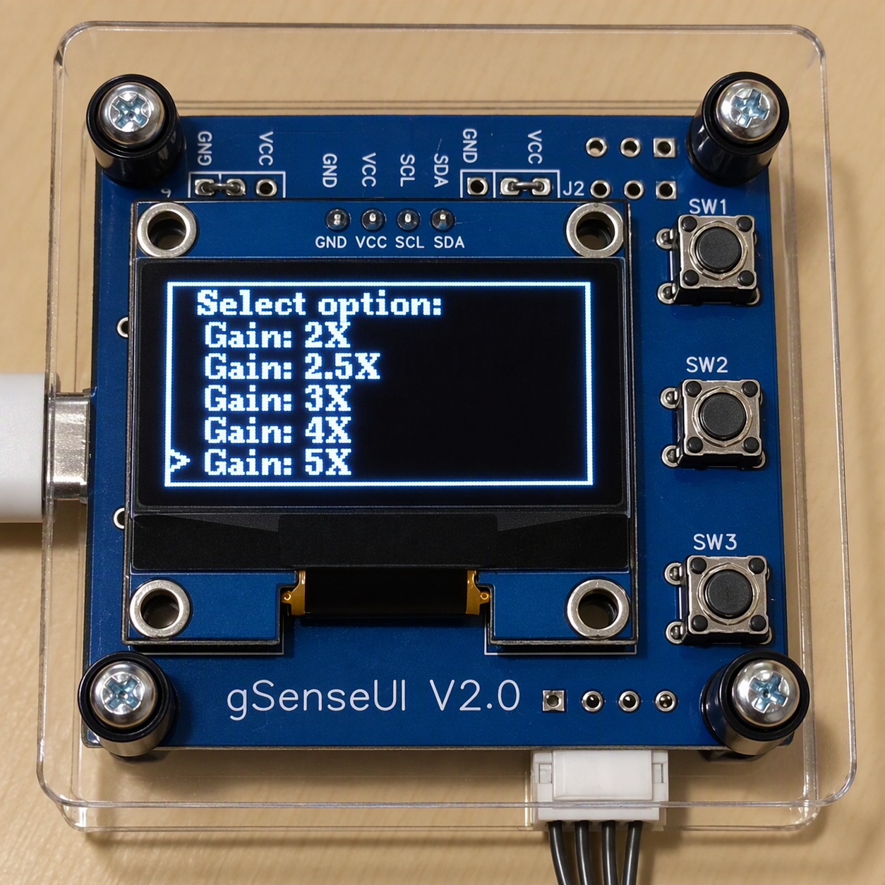
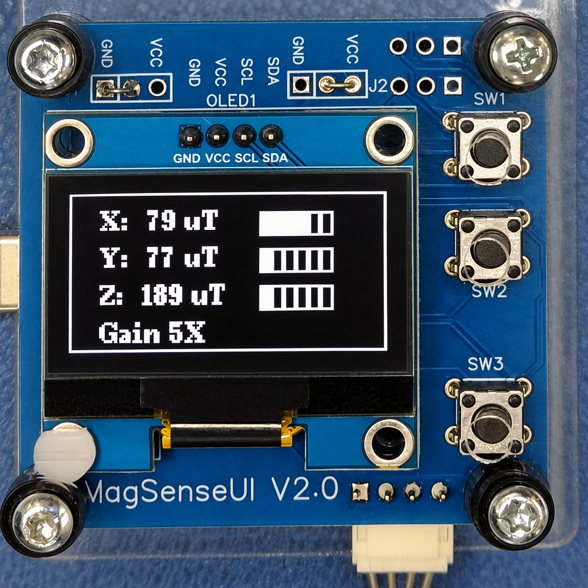
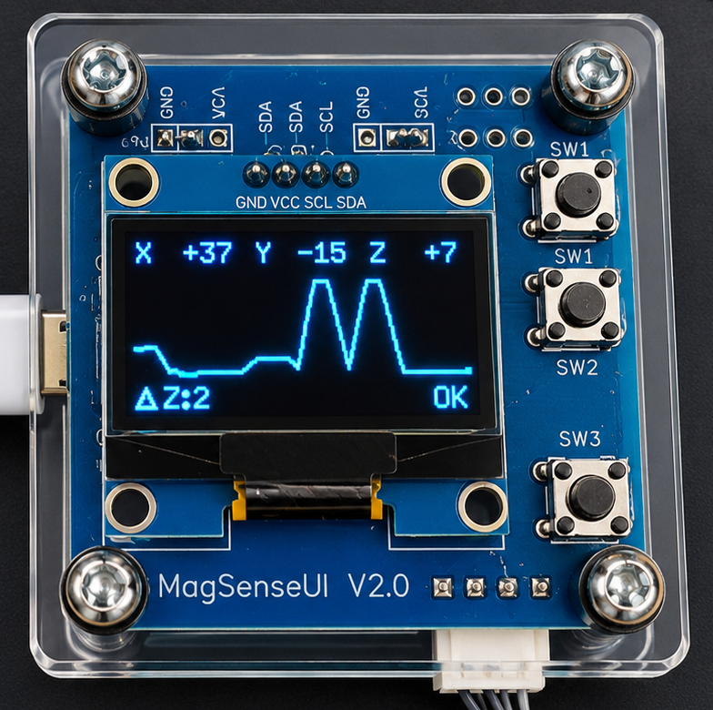
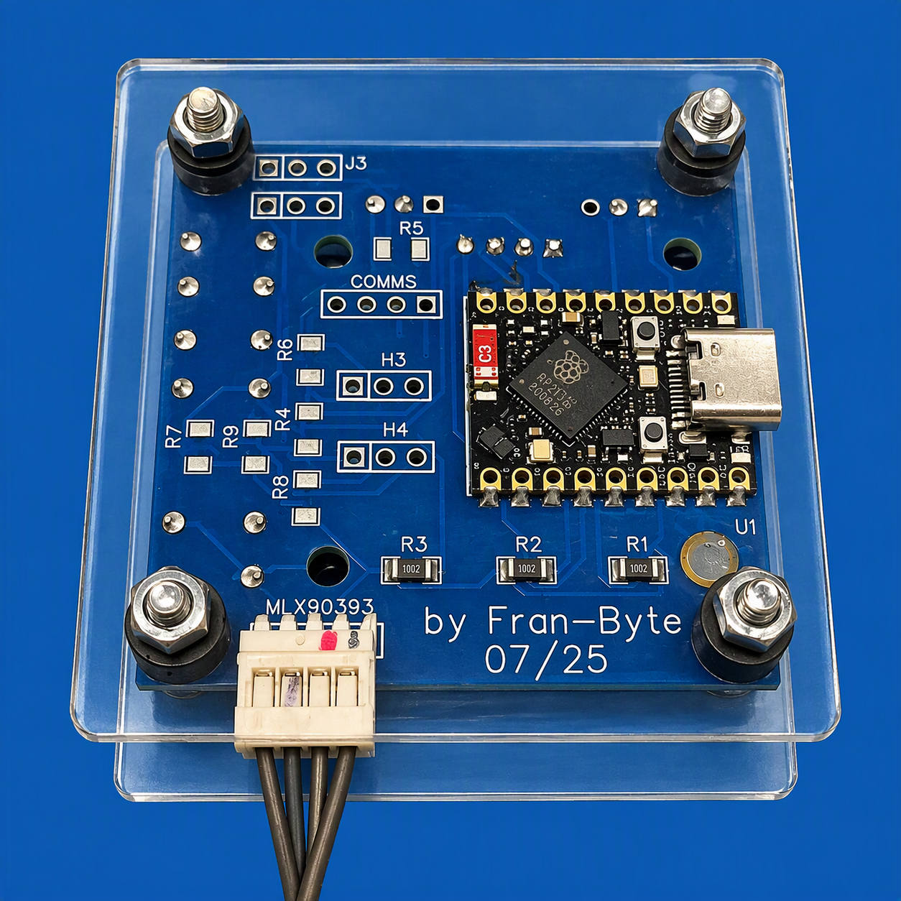
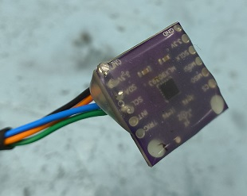

# MagSenseUI

# Diagnostic Tool for Residual Magnetization Detection


## 🎯 Project Purpose

The **MagSenseUI** project was developed to address a specific diagnostic challenge in electromechanical systems, particularly in machines like **Bill Validators** that rely on magnetic sensors for operation.

The program includes an intuitive **menu** system that allows users to configure the **sensor gain** and choose the data output mode. Users can select whether the magnetic field readings are displayed directly on the OLED screen or streamed via the Arduino's **serial port** to a connected PC. This flexibility makes it easy to adapt the system for both standalone field diagnostics and detailed data logging or analysis on a computer.

## Features

- Real-time 3-axis magnetic field monitoring
- Configurable MLX90393 gain levels
- Configurable graph range, WARNING threshold and MAGNETIZED (error) threshold
- OLED user interface with two selectable views (Modern and Classic)
- Diagnostic line showing the axis with the largest field variation (Δ), with peak hold
- Hysteresis on the thresholds (no OK/WARNING flicker)
- Tare button (UP) to restart the measurement from zero
- RGB LED status indicator (green / amber / blinking red)
- Display refresh limited to ~20 fps, I²C at 400 kHz
- EEPROM storage of gain, selected view and ranges
- Serial streaming for PC logging
- Portable diagnostic operation
- Detection of residual bearing magnetization

## 🧰 **Hardware Components**

| Component                           | Description                              |
| ----------------------------------- | ---------------------------------------- |
| [Arduino ESP32](doc/esp32.webp)     | Microcontroller ESP32-S3 Super Mini      |
| [OLED Display 1.3"](doc/SH1106.pdf) | SH1106-based I2C monochrome display      |
| [MLX90393 Sensor](doc/MLX90393.PDF) | 3-axis magnetometer with adjustable gain |
| Push Buttons (x3)                   | For menu navigation and selection        |







- Although the sensor appears to be mounted on the PCB, it is actually connected to it by wires in order to improve its performance and maneuverability.

- Another important point to consider is the use of jumpers J1 and J2, which are used to configure the different versions of the 1.3" OLED displays, as the power supply pins are reversed (positive and negative) in some versions.

## 🧭 **Menu System**

```plaintext
[ MagSenseUI ]                [ Gain ]
-----------------------       -----------------------
Gain 2X >   ---------------->  Gain 1X
Serial ON                      Gain 1.33X
View: Modern                   Gain 1.67X
View: Classic                  Gain 2X
Range: 225 uT                  Gain 2.5X
Warn: 125 uT                   Gain 3X
Error: 175 uT                  Gain 4X
Interval: 500 ms
                               Gain 5X
                               < Back
```

The main menu has 7 entries. `Gain` (which shows the current gain) opens a submenu with the 8 gain levels and `< Back`; picking a gain applies it, saves it to EEPROM and leaves the menu. `Serial ON` enables serial streaming, `View: Modern` / `View: Classic` select the measurement screen (see [Display Views](#display-views)), and `Range`, `Warn`, `Error` and `Interval` are numeric values. The selected view is applied immediately and stored in EEPROM. If the menu times out while the cursor is on a view option, that view is not applied.

To edit a numeric value press SELECT (the value is shown as `<125>`), UP increases and DOWN decreases, SELECT saves it to EEPROM and returns to the list. If the menu times out during an edit, the change is discarded.

| Option                           | Default | Range                |  Step |
| -------------------------------- | ------: | -------------------- | ----: |
| Range (graph full scale)         |  225 uT | 25 - 1000 uT         | 25 uT |
| Warn                             |  125 uT | 5 uT - (Error - 5)   |  5 uT |
| Error                            |  175 uT | (Warn + 5) - 1000 uT |  5 uT |
| Interval (time between readings) |  500 ms | 100 - 2000 ms        | 50 ms |

Warning is always lower than Error: the editor limits each value accordingly.

`Interval` sets the time between readings, and therefore the time base of Δ (variation between two consecutive readings), of the graph (21 samples) and of the serial output. The minimum is 100 ms because the MLX90393 needs ~50 ms or more per conversion with the oversampling and filter in use. Changing it clears the graph, peaks and status. The peak-hold time (3 s) does not depend on the interval.

### 🧩 Problem Context

These machines often operate in environments where **strong neodymium magnets** are permanently present. While these magnets are essential to the machine’s function, they also create a **constant magnetic field** that can interfere with nearby components.

One such component is the metallic bearing. Under normal conditions, the bearing is non-magnetic. However, if it becomes magnetized due to external contamination (e.g., exposure to magnetic particles or prolonged proximity to strong fields), it can distort the local magnetic environment. This distortion may lead to false readings or operational errors in the machine’s magnetic sensors.

### 🧪 Why MagSenseUI?

While a traditional compass can detect strong magnetization, it **fails to detect subtle or low-level magnetization**. This is where **MagSenseUI** excels.

- It uses the **MLX90393** high-resolution 3-axis magnetometer to **detect even slight magnetic anomalies**.
- The system allows the user to **select different gain levels**, enhancing sensitivity to weak fields.
- Through a simple OLED interface and serial output mode, it provides **real-time feedback** on the magnetic field strength in microteslas (µT).
- This enables technicians to **identify which bearing is magnetized**, even if the magnetization is minimal and invisible to conventional tools.

---

## Additional Resources

For readers unfamiliar with the technologies used in this project, detailed background information is available here:

- [I²C Communication Basics](doc/resources.md#i2c)
- [I²C Clock (SCL)](doc/resources.md#i2c-clock)
- [MLX90393 Datasheet](doc/MLX90393.PDF)
- [SH1106 Display Datasheet](doc/SH1106.pdf)

## 🔧 Technical Specifications

### 🧠 ESP32 Mini

The **ESP32 Mini** is a compact, ultra-low-power microcontroller module based on the **ESP32** chip by Espressif. It’s ideal for embedded applications requiring Wi-Fi, Bluetooth, and high processing power in a small footprint.

- **Microcontroller**: Dual-core Xtensa LX7 CPU (up to 240 MHz)
- **Dimensions**: 22.52 × 18 mm
- **Flash Memory**: 4 MB
- **SRAM**: 512 KB
- **ROM**: 384 KB
- **Digital I/O Pins**: 11
- **External Interrupt Pins**: 22
- **Analog Input Pins**: 6
- **PWM Output Pins**: 11
- **Operating Voltage (logic and power)**: 3.3V
- **Input Voltage (via regulator)**: 5V (e.g., via USB-UART adapter)
- **Deep Sleep Current**: ~43 µA
- **Connectivity**: Wi-Fi 802.11 b/g/n, Bluetooth v4.2 BR/EDR + BLE
- **Security Features**: AES-128/256, RSA, HMAC, digital signatures, secure boot
- **Onboard LED**: WS2812 RGB (programmable multicolor status LED)
- **Interfaces**: UART, I2C, SPI, PWM, ADC, DAC
- **USB Interface**: Not built-in (requires external USB-to-Serial adapter for programming)


---

### 🧲 MLX90393 Magnetic Sensor

The **MLX90393** is a highly sensitive 3-axis magnetometer designed for precision magnetic field sensing.

The MLX90393 features a wide dynamic range and programmable gain, allowing it to detect small magnetic field disturbances superimposed on much stronger background magnetic fields generated by sources such as neodymium magnets.

- **Measurement Axes**: X, Y, Z
- **Output**: Magnetic field in microteslas (µT)
- **Resolution**: Configurable (up to 0.161 µT/LSB)
- **Gain Settings**: 1X to 5X (selectable)
- **Interface**: I2C (also supports SPI)
- **I2C Address**: 0x0C (default)
- **Supply Voltage**: 2.2V – 3.6V
- **Current Consumption**: ~2.5 mA (active), ~1 µA (standby)
- **Features**:
  - Programmable gain, resolution, oversampling, and filtering
  - High sensitivity for detecting small magnetic variations
  - Ideal for contactless position sensing and field mapping

### ⚠️ Limitations

The MLX90393 provides a maximum resolution of approximately 0.161 µT/LSB. Measurements near this limit may be affected by sensor noise and environmental magnetic interference.



---

### 🖥️ OLED Display 1.3" (SH1106)

This **1.3-inch OLED** display uses the **SH1106** driver and communicates via I2C. It is perfect for compact UIs in embedded systems.

- **Resolution**: 128 × 64 pixels
- **Display Type**: Monochrome OLED
- **Driver IC**: SH1106
- **Interface**: I2C (SDA/SCL)
- **Operating Voltage**: 3.3V – 5V
- **Power Consumption**: Low (no backlight needed)
- **Viewing Angle**: >160°
- **Library Support**: U8g2, Adafruit SH1106, etc.



### The only difference is the addition of extra GPIO pins reserved for future expansion. The firmware and sensing circuitry remain identical to Version 1.







## Wiring Diagram

## 🔌 Connect Components via I²C (ESP32 Mini)

- **OLED Display (SH1106)**
  - **SDA → GPIO9** PIN 11
  - **SCL → GPIO10** PIN 12

- **MLX90393 Sensor**
  - **SDA → GPIO9** PIN 11
  - **SCL → GPIO10** PIN 12

- **Push Buttons**
  - **UP → GPIO5** PIN 7
  - **DOWN → GPIO6** PIN 8
  - **SELECT → GPIO7** PIN 9

## 🚀 **How to Use**

1. Upload the `MagSenseUI.ino` sketch to your Arduino.
2. At power-up, press SET during the 3-second countdown to enter the setup menu, then use the buttons to navigate it and select gain levels or the display view. Without a SET press, the device skips the menu and starts measuring.
3. Gain and view settings are saved to EEPROM (gain at address 0, view at address 1, range/warn/error/interval as 16-bit values at addresses 2, 4, 6 and 8). On a blank or invalid EEPROM the Modern view and the default values 225/125/175 µT and 500 ms are used.
4. Optionally enable Serial Mode to stream real-time magnetic field data (X, Y, Z in µT) to a PC.

## 🚀 Operation

When powered on, MagSenseUI shows the intro screens and then a 3-second countdown with the message `Press SET for setup`. Pressing SET (or holding it during start-up) opens the configuration menu, where the user can navigate with the push buttons and select the sensor gain, the serial output or the display view. If SET is not pressed, the countdown ends and the device starts measuring directly with the stored settings. The selected gain is automatically restored from EEPROM, allowing the device to retain its previous configuration after a power cycle.

Once the configuration phase has finished, the system begins continuously monitoring the magnetic field on the X, Y and Z axes.

Every _Interval_ (500 ms by default), a new measurement is taken and compared with the previous one. The system calculates the variation of the magnetic field for each axis and displays a visual indication of the detected disturbance level.

### Alert Levels

MagSenseUI compares each measurement with the previous one and calculates the magnetic field variation (Δ).

- Δ ≤ Warn (default 125 µT): Normal condition.
- Δ > Warn (default 125 µT): Warning (triangle with `!`). Small magnetic disturbance detected.
- Δ > Error (default 175 µT): Magnetized (radiation symbol). Significant magnetic disturbance detected, indicating probable residual magnetization in the inspected component.

The warning symbol indicates a moderate magnetic field variation, while the radiation symbol indicates a stronger variation that may be caused by a significantly magnetized nearby component. Thresholds are configurable from the menu and are the same in both views.

This method allows technicians to quickly identify components exhibiting residual magnetization, even when operating within strong background magnetic fields generated by permanent magnets.

### Peak hold, hysteresis, tare and LED

- **Peak hold**: the Δ shown in the bottom bar (and the status, alarms and the classic VU bars) holds the peak of each axis for 3 s before dropping to the current value, so a short spike from a rotating bearing is not missed. The graph always plots the instantaneous Δ.
- **Hysteresis**: a state is entered when Δ exceeds its threshold and only left when Δ falls 5% below it, so the status does not flicker around Warn or Error.
- **Tare (UP button, while measuring)**: current reading becomes the new reference (Δ = 0), and the graph, held peaks and status are cleared. A `TARE` notice is shown for 1 s.
- **LED (WS2812)**: green = OK, amber = WARNING, blinking red = MAGNETIZED (in sync with the inverted bar). It also works in serial mode and is off in the menu or on read error. The LED pin is `LED_PIN` in `alert_led.h` (GPIO48 by default on the ESP32-S3 Super Mini; check it on your board).
- **Performance**: the measurement screen is redrawn at most every 50 ms and the I²C bus runs at 400 kHz.

### Display Views

The measurement screen can be switched from the menu (`View: Modern` / `View: Classic`). Both views use the same Δ calculation and thresholds.

#### Modern view

```plaintext
X +1234   Y +0987   Z  -456
      Δ history graph
Δ Y:188              MAGNETIZED
```

- **X / Y / Z**: current field on each axis in µT.
- **Graph**: history of the largest per-axis variation Δ (the same value shown in the bottom bar) over the last 21 samples (10 s with the default 500 ms interval), across the full display width. Fixed vertical scale from 0 µT (base) to the configured _Range_ (default 225 µT); Δ is always positive, so the line rests on the base with no variation and rises when the field changes. Only the curve is drawn (no reference lines), with a marker on the latest sample. Because Δ is a change between consecutive samples, it works the same inside a large constant background field.
- **Bottom bar**: on the left, the Δ of the axis with the largest variation (`Δ Y:188`); it always shows the axis with the largest variation, whatever the status. On the right, the status: `OK`, `WARNING` or `MAGNETIZED`. In the magnetized state the bar is inverted and blinks every 500 ms.
- The selected gain is not shown in this view.

#### Classic view

Each axis shows its value and a six-segment bar graph that represents the magnitude of the field variation.

- 0 bars: No significant variation detected.
- 6 bars: Variation equal to or greater than the Warn threshold (each bar is Warn/6; about 21 µT with the default 125 µT).
- Warning symbol: Variation above the Warn threshold on that axis.
- Radiation symbol: Variation above the Error threshold on that axis.

The bottom line shows the Δ of the axis with the largest variation on the left (`Δ Y:188`; always shown, whatever the status) and the status (`OK`, `WARNING`, `MAGNETIZED`) on the right.

## Validation Results

| Test Object       | Max Δ (µT) | Status     |
| ----------------- | ---------: | ---------- |
| Reference Bearing |         32 | Normal     |
| Bearing A         |         94 | Normal     |
| Bearing B         |        143 | Warning    |
| Bearing C         |        221 | Magnetized |

📂 **Code**: [View Source Code](magSenseUi/)

## 📄 License

This project is licensed under the MIT License.

## 🙌 Credits

Developed by **Fran-Byte**. Based on Melexis magnetic sensors and Arduino libraries.
